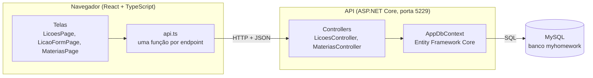
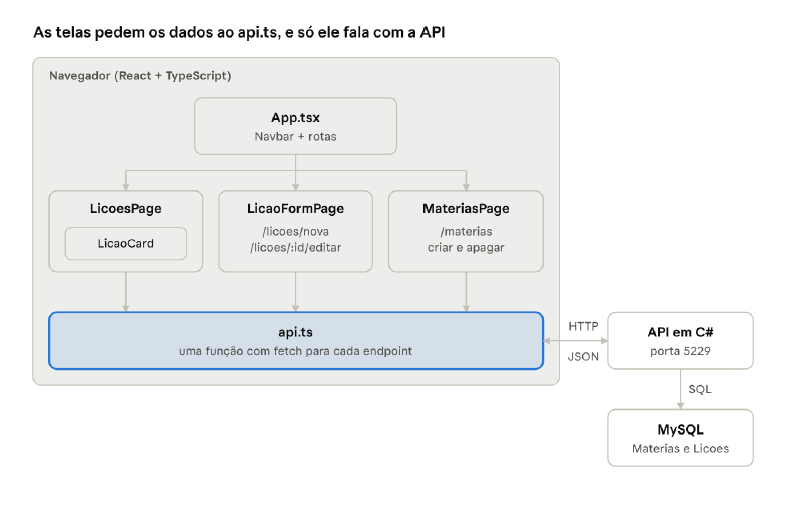

# MyHomework

Aplicação para organizar lições de casa por matéria. Cada matéria agrupa suas lições, e cada lição tem título, descrição, data de entrega e um status que acompanha o andamento: pendente, feita ou entregue.

O projeto é dividido em duas partes que conversam por HTTP:

- **backend**: uma API REST em ASP.NET Core que guarda os dados num banco MySQL;
- **frontend**: uma interface em React que consome essa API.

## Sumário

- [Funcionalidades](#funcionalidades)
- [Tecnologias](#tecnologias)
- [Arquitetura](#arquitetura)
- [Estrutura de pastas](#estrutura-de-pastas)
- [Telas e navegação](#telas-e-navegação)
- [Modelo de dados](#modelo-de-dados)
- [Ciclo de vida de uma lição](#ciclo-de-vida-de-uma-lição)
- [Exemplo de fluxo completo: criar uma lição](#exemplo-de-fluxo-completo-criar-uma-lição)
- [Endpoints da API](#endpoints-da-api)
- [Como rodar](#como-rodar)
- [Decisões do projeto](#decisões-do-projeto)
- [Fluxo de trabalho no Git](#fluxo-de-trabalho-no-git)
- [Próximas etapas](#próximas-etapas)

## Funcionalidades

**Lições**

- listar todas as lições, da entrega mais próxima para a mais distante;
- filtrar por status (todas, pendentes, feitas ou entregues);
- destacar em vermelho as lições pendentes com data de entrega vencida;
- criar e editar lições pelo mesmo formulário;
- marcar uma lição como feita com um clique;
- apagar lições, com confirmação.

**Matérias**

- listar as matérias, cada uma com uma cor própria;
- cadastrar novas matérias;
- apagar matérias, desde que não tenham lições.

A primeira migration já cadastra quatro matérias: Letras, Números, Artes e Natureza.

## Tecnologias

| Camada   | Tecnologia                                   | Uso                                            |
|----------|----------------------------------------------|------------------------------------------------|
| Backend  | .NET 10 e ASP.NET Core                       | API REST com controllers                       |
| Backend  | Entity Framework Core 10                     | acesso ao banco e migrations                   |
| Backend  | `MySql.EntityFrameworkCore`                  | provedor oficial do MySQL para o EF Core       |
| Backend  | Swagger (Swashbuckle)                        | documentação e testes dos endpoints            |
| Banco    | MySQL                                        | armazenamento das matérias e lições            |
| Frontend | React 19 com TypeScript                      | interface                                      |
| Frontend | React Router                                 | navegação entre as telas                       |
| Frontend | Vite                                         | servidor de desenvolvimento e build            |
| Frontend | `fetch` nativo                               | chamadas à API, sem bibliotecas extras         |

## Arquitetura

Cada camada só conversa com a camada vizinha. As telas não fazem requisições: elas chamam funções de `api.ts`. Os controllers não escrevem SQL: eles usam o `AppDbContext`, que o Entity Framework traduz em comandos para o MySQL.



O mesmo desenho, com as rotas de cada tela:



## Estrutura de pastas

```
backend/
  MyHomework.slnx
  MyHomework.Api/
    Controllers/
      LicoesController.cs     endpoints de lições
      MateriasController.cs   endpoints de matérias
    Data/
      AppDbContext.cs         tabelas, regras e dados iniciais
    Migrations/               histórico do esquema do banco
    Models/
      Licao.cs                classe Licao e enum StatusLicao
      Materia.cs              classe Materia
    Program.cs                configuração: banco, JSON, Swagger, CORS

frontend/
  .env.example                modelo da variável com o endereço da API
  index.html
  src/
    api/
      api.ts                  todas as chamadas à API
    components/
      LicaoCard.tsx           card de uma lição
      Navbar.tsx              barra de navegação
    pages/
      LicoesPage.tsx          lista de lições com filtros
      LicaoFormPage.tsx       formulário de criar e editar lição
      MateriasPage.tsx        lista e cadastro de matérias
    utils/
      cores.ts                cor de cada matéria
      datas.ts                formatação de datas e regra de atraso
    types.ts                  formato dos dados da API
    App.tsx                   rotas
    index.css                 estilos
    main.tsx                  ponto de entrada

docs/                         imagens usadas neste README
```

## Telas e navegação

| Rota                  | Tela            | O que faz                                              |
|-----------------------|-----------------|--------------------------------------------------------|
| `/`                   | `LicoesPage`    | lista as lições, com filtros e ações em cada card      |
| `/licoes/nova`        | `LicaoFormPage` | formulário vazio para criar uma lição                  |
| `/licoes/:id/editar`  | `LicaoFormPage` | o mesmo formulário, preenchido com a lição escolhida   |
| `/materias`           | `MateriasPage`  | lista as matérias e permite cadastrar e apagar         |

A barra de navegação aparece em todas as telas. Na lista de lições, o botão "+ Nova lição" e o botão "Editar" de cada card abrem o formulário; ao salvar ou cancelar, o formulário volta para a lista. "Marcar como feita" e "Apagar" agem na própria lista, sem trocar de tela.

## Modelo de dados

Uma matéria tem várias lições, e cada lição pertence a uma única matéria, ligada pelo campo `MateriaId`.

**Materia**

| Campo    | Tipo     | Observação                     |
|----------|----------|--------------------------------|
| Id       | int      | chave primária                 |
| Nome     | string   | obrigatório, até 60 caracteres |
| Icone    | string   | opcional, até 10 caracteres    |
| CriadaEm | DateTime | preenchido pela API            |

**Licao**

| Campo        | Tipo      | Observação                         |
|--------------|-----------|------------------------------------|
| Id           | int       | chave primária                     |
| Titulo       | string    | obrigatório, até 120 caracteres    |
| Descricao    | string    | opcional, até 500 caracteres       |
| DataEntrega  | DateTime  |                                    |
| Status       | enum      | `Pendente`, `Feita` ou `Entregue`  |
| ConcluidaEm  | DateTime? | preenchido ao concluir a lição     |
| CriadaEm     | DateTime  | preenchido pela API                |
| AtualizadaEm | DateTime? | preenchido pela API a cada edição  |
| MateriaId    | int       | chave estrangeira para `Materia`   |

Regras que valem para os dados:

- o status é gravado no banco como texto e aparece assim no JSON (`"Pendente"`, e não `0`);
- `CriadaEm`, `AtualizadaEm` e `ConcluidaEm` são preenchidos pela API, nunca pelo cliente;
- uma matéria só pode ser apagada se não tiver lições. A regra existe no banco (`DeleteBehavior.Restrict`) e também no controller, que responde com `400` e uma mensagem clara.

## Ciclo de vida de uma lição

| Ação                         | Endpoint                 | Efeito no status                         |
|------------------------------|--------------------------|------------------------------------------|
| Criar                        | `POST /api/licoes`       | sempre começa como `Pendente`            |
| Marcar como feita            | `PATCH .../concluir`     | vira `Feita` e registra `ConcluidaEm`    |
| Editar no formulário         | `PUT /api/licoes/{id}`   | pode ir para qualquer um dos três        |
| Apagar                       | `DELETE /api/licoes/{id}`| a lição deixa de existir                 |

Na tela, uma lição aparece como **atrasada** quando ainda está `Pendente` e a data de entrega já passou.

## Exemplo de fluxo completo: criar uma lição

O que acontece entre o clique em "Salvar" e a lição aparecer na lista:

1. O aluno preenche o formulário (`LicaoFormPage`) e clica em Salvar.
2. A tela chama `criarLicao(dados)`, em `api.ts`.
3. O `api.ts` envia um `POST /api/licoes` com os dados em JSON.
4. O `LicoesController` confere no banco se a matéria informada existe.
5. Se não existe, a API responde `400` com "Matéria não encontrada.", e a tela mostra essa mensagem em vermelho.
6. Se existe, a API define o status como `Pendente`, preenche `CriadaEm`, grava a lição no MySQL e responde `200` com a lição criada.
7. A tela volta para a lista, que busca as lições de novo e já mostra a nova.

## Endpoints da API

A documentação interativa fica em `http://localhost:5229/swagger` quando a API está rodando.

### Matérias

| Método | Rota                 | Descrição                                | Respostas          |
|--------|----------------------|------------------------------------------|--------------------|
| GET    | `/api/materias`      | lista todas as matérias                  | 200                |
| GET    | `/api/materias/{id}` | busca uma matéria                        | 200, 404           |
| POST   | `/api/materias`      | cria uma matéria                         | 200, 400           |
| PUT    | `/api/materias/{id}` | altera nome e ícone                      | 200, 404           |
| DELETE | `/api/materias/{id}` | apaga a matéria, se ela não tiver lições | 204, 400, 404      |

### Lições

| Método | Rota                         | Descrição                  | Respostas     |
|--------|------------------------------|----------------------------|---------------|
| GET    | `/api/licoes`                | lista todas as lições      | 200           |
| GET    | `/api/licoes/{id}`           | busca uma lição            | 200, 404      |
| POST   | `/api/licoes`                | cria uma lição             | 200, 400      |
| PUT    | `/api/licoes/{id}`           | edita uma lição            | 200, 404      |
| PATCH  | `/api/licoes/{id}/concluir`  | marca a lição como feita   | 200, 404      |
| DELETE | `/api/licoes/{id}`           | apaga uma lição            | 204, 404      |

Exemplo de corpo para criar uma lição:

```json
{
  "titulo": "Ler o capítulo 1",
  "descricao": "Páginas 10 a 15",
  "dataEntrega": "2026-12-01T00:00:00",
  "materiaId": 2
}
```

Ao criar uma lição, a API ignora o que vier em `status`, `criadaEm`, `atualizadaEm` e `concluidaEm`: toda lição nova começa como `Pendente`. Se o `materiaId` não existir, a resposta é `400`.

## Como rodar

### Requisitos

- [.NET SDK 10](https://dotnet.microsoft.com/download)
- MySQL rodando localmente, na porta 3306
- Ferramenta do Entity Framework: `dotnet tool install -g dotnet-ef`
- [Node.js](https://nodejs.org/) 20.19 ou 22.12 em diante

### Backend

**1. Configurar a conexão com o banco**

A senha do banco não fica no repositório. Em desenvolvimento ela é guardada com o User Secrets do .NET, que salva os dados fora da pasta do projeto:

```bash
cd backend/MyHomework.Api
dotnet user-secrets set "ConnectionStrings:Default" "server=localhost;port=3306;database=myhomework;user=root;password=SUA_SENHA"
```

O `appsettings.Development.json` traz a mesma connection string com a senha em branco, só como referência do formato.

**2. Criar o banco**

```bash
dotnet ef database update
```

O comando cria o banco `myhomework`, as tabelas e as matérias iniciais.

**3. Subir a API**

```bash
dotnet run
```

A API fica em `http://localhost:5229`.

### Frontend

Com a API rodando, abra outro terminal:

```bash
cd frontend
npm install
```

Crie o arquivo `.env.local` a partir do modelo. Ele guarda o endereço da API e não vai para o repositório:

```bash
cp .env.example .env.local
```

No Windows (PowerShell), use `Copy-Item .env.example .env.local`. Se a sua API estiver em outra porta, ajuste o valor de `VITE_API_URL`.

Depois suba o servidor de desenvolvimento:

```bash
npm run dev
```

O site fica em `http://localhost:5173`, endereço que a API já libera no CORS.

## Decisões do projeto

| Decisão | Motivo |
|---------|--------|
| Todas as chamadas HTTP ficam em `api.ts` | as telas não precisam conhecer endereços nem tratar erros de rede; trocar a URL da API muda um arquivo só |
| O card de lição não chama a API | ele só avisa a página ("clicaram em concluir"); quem fala com a API é a página, e o card fica simples de reaproveitar |
| Status salvo como texto | o banco e o JSON ficam legíveis (`Pendente` em vez de `0`) |
| Cor da matéria calculada pelo `id` | não precisa de coluna no banco e cada matéria mantém sempre a mesma cor |
| Senha do banco no User Secrets | a senha nunca entra no Git, nem por engano |
| Endereço da API em `.env.local` | cada computador pode usar a sua porta sem mudar o código |
| Matéria com lições não pode ser apagada | evita lições sem matéria; a API explica o motivo em vez de devolver erro 500 |

## Fluxo de trabalho no Git

Cada parte do projeto foi feita numa branch própria e entrou no `main` por pull request. As mensagens de commit seguem o padrão [Conventional Commits](https://www.conventionalcommits.org/):

| Tipo       | Uso                                  | Exemplo                                                    |
|------------|--------------------------------------|------------------------------------------------------------|
| `feat`     | funcionalidade nova                  | `feat(licoes): add LicoesController with CRUD endpoints`   |
| `fix`      | correção de bug                      | `fix(licoes): validate materia on update`                  |
| `docs`     | documentação                         | `docs: add project README`                                 |
| `build`    | dependências                         | `build(deps): add react-router`                            |
| `chore`    | configuração e manutenção            | `chore(frontend): scaffold React app with Vite`            |

## Próximas etapas

Melhorias planejadas, agrupadas por área.

### Backend

| Melhoria | Por quê |
|----------|---------|
| Exigir `Nome` não vazio na matéria (`[Required]`) | hoje a API aceita uma matéria com nome em branco; só o formulário do frontend impede |
| Validar a matéria também no `PUT` de lições | com um `materiaId` inexistente, a edição devolve erro 500 em vez de 400 |
| Ignorar o `id` enviado no `POST` | se o cliente mandar um `id`, a criação pode falhar com chave duplicada |
| Preencher `ConcluidaEm` quando o status virar `Feita` pelo `PUT` | hoje só o botão "Marcar como feita" registra a data |
| Usar DTOs de entrada e saída | separar o que a API recebe do que ela grava, em vez de usar as classes do banco direto |
| Responder `201 Created` no `POST` | é a resposta padrão do HTTP para criação |
| Remover o pacote `Microsoft.AspNetCore.OpenApi` | não é mais usado; a documentação vem do Swashbuckle |

### Frontend

| Melhoria | Por quê |
|----------|---------|
| Layout responsivo para celular | a tela foi pensada para computador |
| Filtro por matéria na lista de lições | hoje só existe o filtro por status |
| Editar o nome de uma matéria | a API já tem o endpoint, falta a tela |
| Botão "Marcar como entregue" no card | hoje só dá para mudar para `Entregue` pelo formulário |
| Contador de pendentes e atrasadas no topo | visão rápida do que falta fazer |
| Confirmação de exclusão com componente próprio | substituir o `confirm()` do navegador |

### Qualidade e entrega

| Melhoria | Por quê |
|----------|---------|
| Testes da API com xUnit | garantir as regras de negócio a cada mudança |
| Testes do frontend com Vitest | testar componentes e funções como `estaAtrasada` |
| GitHub Actions | compilar e testar automaticamente a cada pull request |
| Docker Compose com API, MySQL e frontend | subir o projeto inteiro com um comando |
| Publicar a aplicação | deixar o projeto acessível fora do computador local |

### Novas funcionalidades

| Ideia | Descrição |
|-------|-----------|
| Login | cada aluno vê só as próprias lições |
| Lembretes | avisar quando uma lição estiver perto do prazo |
| Calendário | ver as entregas organizadas por dia |
| Anexos | guardar uma foto ou arquivo junto com a lição |

A ordem sugerida é: primeiro as correções da API, depois as melhorias de tela, em seguida testes e CI, então Docker e publicação, e por último as novas funcionalidades.
