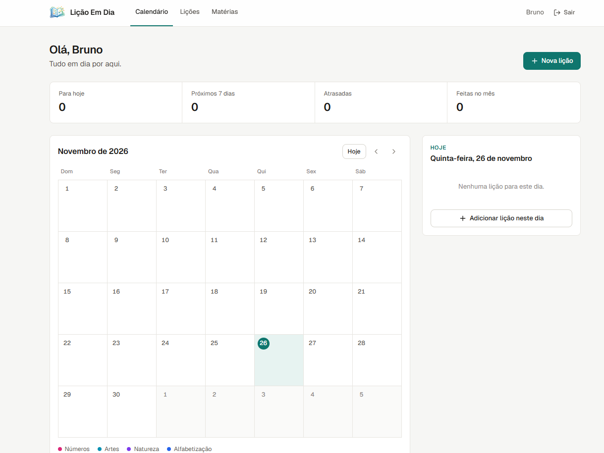
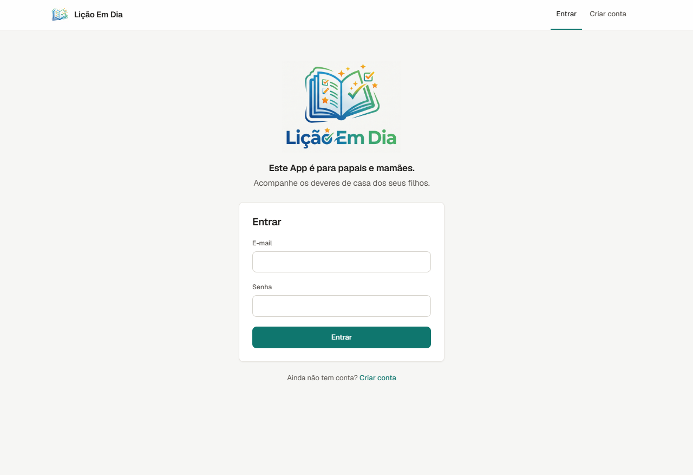
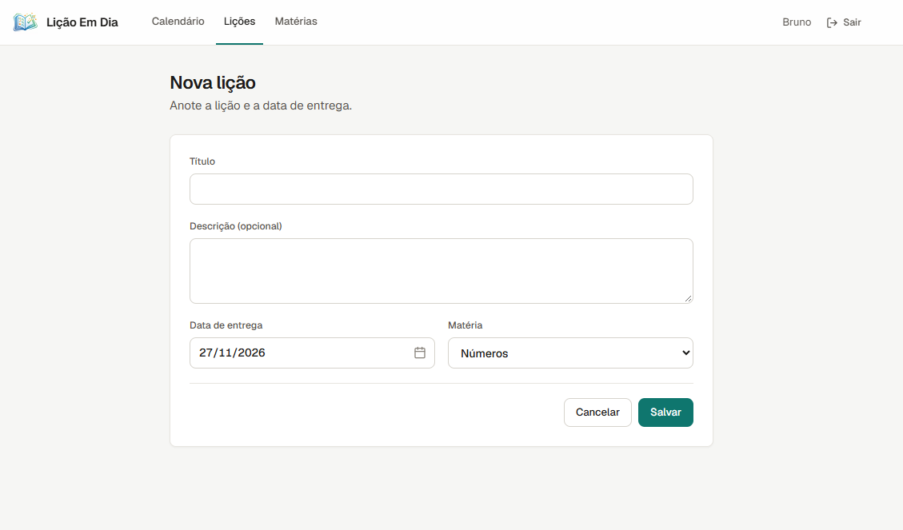
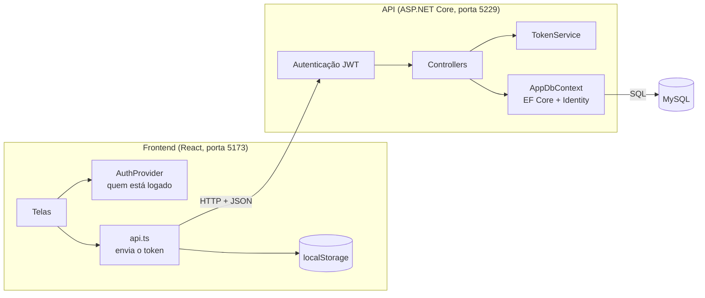
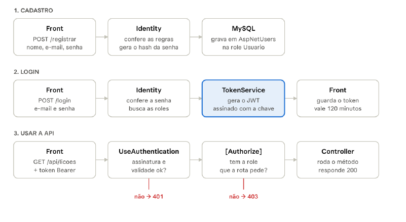
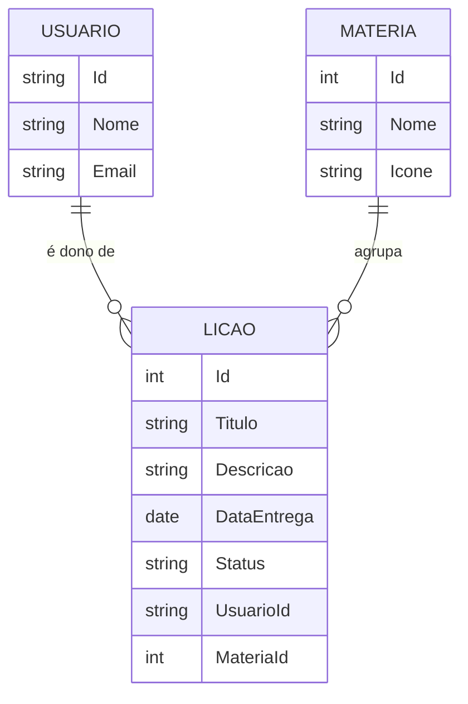

# Lição Em Dia

> [!IMPORTANT]
> **Este app é para ser usado somente por responsáveis: papais e mamães.** Quem cria a conta, faz o login, cadastra as lições e acompanha o andamento é sempre o responsável.
>
> **O projeto não está em produção.** É apenas uma ideia para melhorar o meu dia a dia no acompanhamento dos deveres escolares da minha filha.

**Um projeto pessoal para acompanhar lições de casa.**

Criei o Lição Em Dia para atender uma necessidade minha: ter um jeito simples de saber quais lições existem, para quando são e o que já foi feito. É um **MVP** (produto mínimo viável) para a minha rotina em casa. Não é um produto e não é comercial.

O projeto também é a forma que encontrei de estudar e praticar ASP.NET Core, Entity Framework, autenticação com JWT e React, construindo algo que eu mesmo uso.

## Sumário

- [Telas](#telas)
- [Funcionalidades](#funcionalidades)
- [Tecnologias](#tecnologias)
- [Arquitetura](#arquitetura)
- [Autenticação e permissões](#autenticação-e-permissões)
- [Modelo de dados e regras](#modelo-de-dados-e-regras)
- [Endpoints da API](#endpoints-da-api)
- [Como rodar](#como-rodar)
- [Decisões do projeto](#decisões-do-projeto)
- [Próximas etapas](#próximas-etapas)

## Telas

### Calendário (página inicial)



É a primeira tela depois do login. No topo, um resumo com as lições para hoje, para os próximos 7 dias, as atrasadas e as feitas no mês. A grade mostra as lições de cada dia na cor da matéria: atrasadas em vermelho e concluídas riscadas. Ao clicar num dia, o painel da direita lista as lições daquele dia, com os botões para concluir, editar e adicionar uma lição já com a data preenchida.

### Login e cadastro



Quem não está logado só vê o login e o cadastro. Depois de criar a conta, a pessoa volta para o login com o aviso "Conta criada" e o e-mail já preenchido.

### Nova lição



### Outras telas

| Rota                 | Tela          | O que faz |
|----------------------|---------------|-----------|
| `/licoes`            | Lições        | lista em linhas, com filtro por status e contagem em cada filtro; concluir, editar e apagar em cada linha |
| `/licoes/nova`       | Nova lição    | formulário com título, descrição, data de entrega e matéria; aceita `?data=2026-11-27` para vir com o dia preenchido |
| `/licoes/:id/editar` | Editar lição  | o mesmo formulário, preenchido, com o campo de status |
| `/materias`          | Matérias      | lista com a cor de cada matéria; o admin também cadastra e apaga |

O formulário de lição volta para a tela de onde foi aberto (calendário ou lista). O campo de data abre um calendário próprio em português (dd/mm/aaaa), com atalhos "Hoje", "Amanhã" e "Daqui a 1 semana". Ele não usa o `<input type="date">` do navegador, que em inglês mostra `mm/dd/yyyy`.

## Funcionalidades

**Lições**
- cadastrar, editar, concluir e apagar;
- filtrar por status (todas, pendentes, feitas, entregues);
- destaque para as atrasadas: pendentes com a data de entrega já passada;
- cada conta vê e altera somente as próprias lições.

**Matérias**
- cada matéria tem uma cor fixa, calculada pelo `id`, usada no calendário e na lista;
- só o administrador cadastra, edita e apaga;
- uma matéria com lições não pode ser apagada.

**Contas**
- cadastro com nome, e-mail e senha;
- login com token JWT, guardado no navegador;
- a sessão continua ao recarregar a página, até o token vencer (120 minutos);
- quando o token vence ou é recusado, o app volta para o login com o aviso "Sua sessão expirou".

## Tecnologias

| Camada   | Tecnologias |
|----------|-------------|
| Backend  | .NET 10, ASP.NET Core (controllers), Entity Framework Core 10, ASP.NET Core Identity, JWT Bearer, Swagger (Swashbuckle) |
| Banco    | MySQL, com o provedor oficial `MySql.EntityFrameworkCore` |
| Frontend | React 19, TypeScript, React Router, Vite, `fetch` nativo e CSS puro (sem biblioteca de componentes) |

## Arquitetura



**Backend**
- Os controllers não escrevem SQL: usam o `AppDbContext` (lições e matérias) e o `UserManager` do Identity (usuários).
- Cadastro e login usam DTOs, para não expor campos como o `PasswordHash`.
- O `TokenService` gera o JWT no login. O `SeedData` cria as roles e o primeiro admin ao subir a API.

**Frontend**
- As telas não fazem requisições direto: tudo passa por `api.ts`, que coloca o token no cabeçalho `Authorization` e trata `401` e `403`.
- O `AuthProvider` guarda quem está logado, e as telas consultam com o hook `useAuth()`. O `RotaProtegida` manda para o login quem não está logado.
- Datas são tratadas em `utils/datas.ts`, sempre no fuso local, para evitar que `2026-11-27` vire o dia anterior no Brasil.

Cada parte tem um README com mais detalhes: [backend](backend/README.md) e [frontend](frontend/README.md).

```
backend/MyHomework.Api/
  Controllers/    AuthController, LicoesController, MateriasController
  Data/           AppDbContext e SeedData
  DTOs/           dados de cadastro e login
  Models/         Licao, Materia, Usuario e Roles
  Services/       TokenService
  Migrations/     histórico do banco
  Program.cs      configuração: banco, Identity, JWT, Swagger, CORS

frontend/src/
  api/            api.ts (chamadas) e sessao.ts (token no navegador)
  components/     Navbar, LicaoCard, CampoData, RotaProtegida, Icones
  contexts/       AuthProvider e useAuth()
  pages/          Calendario, Licoes, LicaoForm, Materias, Login, Registro
  utils/          datas e cores
```

## Autenticação e permissões



1. **Cadastro:** o front envia nome, e-mail e senha. O Identity confere as regras da senha, gera o hash e grava o usuário com a role `Usuario`.
2. **Login:** o Identity confere a senha e busca as roles. O `TokenService` gera um JWT assinado com a chave secreta, que vale 120 minutos. O front guarda o token.
3. **Uso da API:** cada requisição leva o token no cabeçalho `Authorization: Bearer`. A API confere a assinatura e a validade (sem token válido: `401`) e depois se a conta tem a role exigida (sem a role: `403`).

| Perfil    | Quem recebe | O que pode fazer |
|-----------|-------------|------------------|
| `Usuario` | toda conta criada pelo cadastro | ver matérias; cadastrar, editar, concluir e apagar as próprias lições |
| `Admin`   | o primeiro admin, criado a partir do User Secrets | tudo o que o `Usuario` faz, mais cadastrar, editar e apagar matérias |

- **Senha:** pelo menos 6 caracteres, com um número e uma letra minúscula.
- **Token:** leva o id (`sub`), o e-mail, o nome e as roles da conta.
- **Login com erro:** e-mail inexistente e senha errada recebem a mesma mensagem, para não revelar quais e-mails têm conta.

## Modelo de dados e regras



- **Status da lição:** toda lição nova começa como `Pendente`. "Marcar como feita" muda para `Feita` e registra a data de conclusão. Pelo formulário, o status pode ir para qualquer um dos três, inclusive `Entregue`.
- **Atrasada:** a lição está `Pendente` e a data de entrega já passou.
- **Dono:** a API preenche o `UsuarioId` a partir do token e filtra todas as rotas de lições por ele. A lição de outra conta responde `404`, como se não existisse. Se a conta for apagada, as lições dela vão junto.
- **Matéria com lições:** não pode ser apagada. A regra existe no banco e no controller, que responde `400` com uma mensagem clara.
- **Campos da API:** datas de criação, atualização e conclusão são sempre preenchidas pela API, nunca pelo cliente. O status é gravado como texto (`"Pendente"`, e não `0`).

## Endpoints da API

Documentação interativa em `http://localhost:5229/swagger`. Para testar as rotas protegidas, faça o login, copie o `token` da resposta e cole no botão **Authorize**.


| Método | Rota | Acesso | O que faz |
|--------|------|--------|-----------|
| POST   | `/api/auth/registrar` | público | cria a conta com a role `Usuario` |
| POST   | `/api/auth/login` | público | devolve o token, o nome, o e-mail e as roles |
| GET    | `/api/auth/me` | logado | devolve os dados do token |
| GET    | `/api/licoes` | logado | lista as lições da conta |
| GET    | `/api/licoes/{id}` | logado | busca uma lição da conta |
| POST   | `/api/licoes` | logado | cria uma lição |
| PUT    | `/api/licoes/{id}` | logado | edita uma lição |
| PATCH  | `/api/licoes/{id}/concluir` | logado | marca como feita |
| DELETE | `/api/licoes/{id}` | logado | apaga uma lição |
| GET    | `/api/materias` e `/api/materias/{id}` | logado | lista ou busca matérias |
| POST, PUT, DELETE | `/api/materias` e `/api/materias/{id}` | Admin | cria, edita ou apaga matérias |

## Como rodar

**Requisitos:** .NET SDK 10, MySQL na porta 3306, `dotnet-ef` (`dotnet tool install -g dotnet-ef`) e Node.js 20.19+.

**1. Backend**

Senhas e chaves ficam no User Secrets do .NET, fora do repositório:

```bash
cd backend/MyHomework.Api

dotnet user-secrets set "ConnectionStrings:Default" "server=localhost;port=3306;database=myhomework;user=root;password=SUA_SENHA"
dotnet user-secrets set "Jwt:Key" "UMA-CHAVE-ALEATORIA-COM-32-OU-MAIS-CARACTERES"
dotnet user-secrets set "AdminInicial:Email" "admin@exemplo.com"
dotnet user-secrets set "AdminInicial:Senha" "SUA_SENHA_DE_ADMIN"

dotnet ef database update   # cria o banco, as tabelas e as matérias iniciais
dotnet run                  # API em http://localhost:5229
```

Sem `Jwt:Key`, a API não sobe. Sem `AdminInicial`, ela sobe normalmente, mas nenhum admin é criado.

**2. Frontend** (em outro terminal)

```bash
cd frontend
npm install
cp .env.example .env.local   # no PowerShell: Copy-Item .env.example .env.local
npm run dev                  # site em http://localhost:5173
```

O `.env.local` guarda o endereço da API (`VITE_API_URL`). Abra `http://localhost:5173`, crie uma conta ou entre com o admin configurado.

## Decisões do projeto

| Decisão | Motivo |
|---------|--------|
| Identity para os usuários | hash de senha, regras de senha, e-mail único e roles prontos, sem reinventar segurança |
| JWT em vez de cookie | API e front rodam em portas diferentes, e o token funciona igual no navegador e no Swagger |
| Dono da lição preenchido pela API | o cliente nunca escolhe o dono; ele vem do token |
| Lição de outra conta responde `404` | não revela que a lição existe |
| Todas as chamadas em `api.ts` | as telas não conhecem endereços nem tratam erros de rede |
| Calendário e campo de data feitos à mão | poucas funções em `datas.ts` resolvem, sem dependências extras, e sempre em português |
| Segredos no User Secrets | senha do banco, chave do JWT e admin nunca entram no Git |

## Próximas etapas

- Traduzir para o português as mensagens de senha do Identity.
- Usar DTOs também em lições e matérias, e validar a matéria no `PUT` de lições.
- Lembretes de prazo e visão por semana no calendário.
- Testes (xUnit e Vitest), GitHub Actions e Docker Compose.
