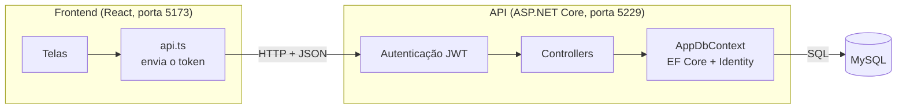
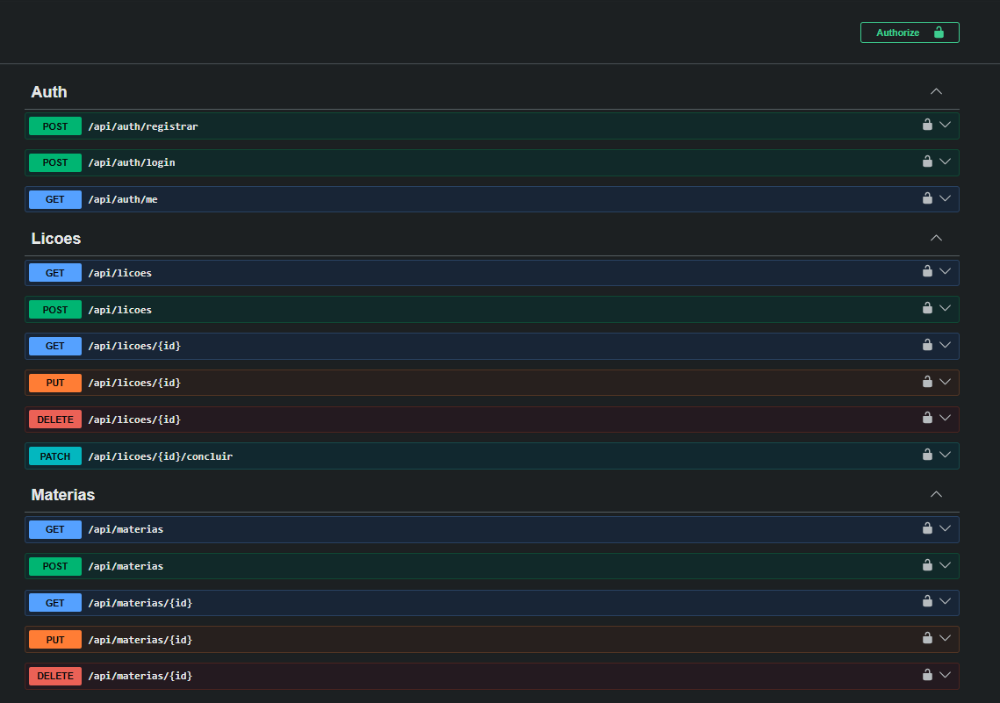

# MyHomework

> [!IMPORTANT]
> **Este app é para ser usado somente por responsáveis: papais e mamães.** Quem cria a conta, faz o login, cadastra as lições e acompanha o andamento é sempre o responsável.
>
> **O projeto não está em produção.** É apenas uma ideia para melhorar o meu dia a dia no acompanhamento dos deveres escolares da minha filha.

**Um projeto pessoal para acompanhar lições de casa.**

Criei o MyHomework para atender uma necessidade minha: ter um jeito simples de saber quais lições existem, para quando são e o que já foi feito. É um **MVP** (produto mínimo viável) para a minha rotina em casa. Não é um produto e não é comercial.

O projeto também é a forma que encontrei de estudar e praticar ASP.NET Core, Entity Framework, autenticação com JWT e React, construindo algo que eu mesmo uso.

## Funcionalidades

- **Calendário (página inicial):** resumo do dia (para hoje, próximos 7 dias, atrasadas e feitas no mês), grade do mês com as lições na cor da matéria e painel com as lições do dia escolhido.
- **Lições:** lista com filtro por status, criação e edição, data de entrega escolhida num calendário em português (dd/mm/aaaa), "Marcar como feita" e exclusão. Lições pendentes com prazo vencido aparecem em vermelho.
- **Matérias:** lista com cor própria para cada uma. Só o administrador cadastra, edita e apaga.
- **Contas:** cadastro, login com token JWT, sessão mantida ao recarregar a página e volta automática para o login quando o token vence.

Cada lição tem título, descrição, data de entrega, matéria e status: `Pendente`, `Feita` ou `Entregue`.

## Tecnologias

| Camada   | Tecnologias |
|----------|-------------|
| Backend  | .NET 10, ASP.NET Core, Entity Framework Core 10, ASP.NET Core Identity, JWT Bearer, Swagger |
| Banco    | MySQL (`MySql.EntityFrameworkCore`) |
| Frontend | React 19, TypeScript, React Router, Vite e `fetch` nativo |

## Arquitetura



- As telas não fazem requisições direto: tudo passa por `api.ts`, que coloca o token no cabeçalho `Authorization`.
- Quem está logado fica no `AuthProvider`, e as telas consultam com o hook `useAuth()`.
- Existem dois perfis: **Usuario** (cuida das lições) e **Admin** (também gerencia as matérias). Toda conta nova é `Usuario`, e o primeiro admin é criado ao subir a API.

```
backend/MyHomework.Api/   Controllers, Data, DTOs, Models, Services, Migrations, Program.cs
frontend/src/             api, components, contexts, pages, utils, App.tsx
```

## Endpoints da API

Documentação interativa em `http://localhost:5229/swagger`.



| Método | Rota                           | Acesso  |
|--------|--------------------------------|---------|
| POST   | `/api/auth/registrar`          | público |
| POST   | `/api/auth/login`              | público |
| GET    | `/api/auth/me`                 | logado  |
| GET    | `/api/licoes` e `/api/licoes/{id}` | logado  |
| POST, PUT, DELETE | `/api/licoes` e `/api/licoes/{id}` | logado |
| PATCH  | `/api/licoes/{id}/concluir`    | logado  |
| GET    | `/api/materias` e `/api/materias/{id}` | logado |
| POST, PUT, DELETE | `/api/materias` e `/api/materias/{id}` | Admin |

Sem token, a API responde `401`. Com token, mas sem a role exigida, responde `403`.

## Como rodar

**Requisitos:** .NET SDK 10, MySQL na porta 3306, `dotnet-ef` (`dotnet tool install -g dotnet-ef`) e Node.js 20.19+.

**1. Backend**

```bash
cd backend/MyHomework.Api

dotnet user-secrets set "ConnectionStrings:Default" "server=localhost;port=3306;database=myhomework;user=root;password=SUA_SENHA"
dotnet user-secrets set "Jwt:Key" "UMA-CHAVE-ALEATORIA-COM-32-OU-MAIS-CARACTERES"
dotnet user-secrets set "AdminInicial:Email" "admin@exemplo.com"
dotnet user-secrets set "AdminInicial:Senha" "SUA_SENHA_DE_ADMIN"

dotnet ef database update
dotnet run
```

A senha precisa ter pelo menos 6 caracteres, com um número e uma letra minúscula.

**2. Frontend** (em outro terminal)

```bash
cd frontend
npm install
cp .env.example .env.local   # no PowerShell: Copy-Item .env.example .env.local
npm run dev
```

Abra `http://localhost:5173`, crie uma conta ou entre com o admin configurado.

## Próximas etapas

- Ligar cada lição a um usuário (hoje qualquer conta logada vê todas as lições).
- Traduzir para o português as mensagens de senha do Identity.
- Usar DTOs também em lições e matérias, e validar a matéria no `PUT` de lições.
- Lembretes de prazo e visão por semana no calendário.
- Testes (xUnit e Vitest), GitHub Actions e Docker Compose.
- Hospedar a aplicação para usar pelo celular fora de casa.
