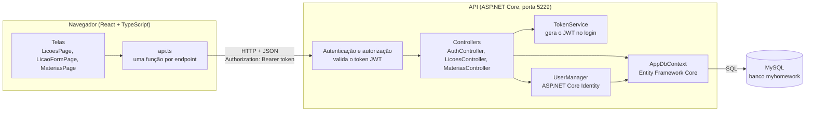
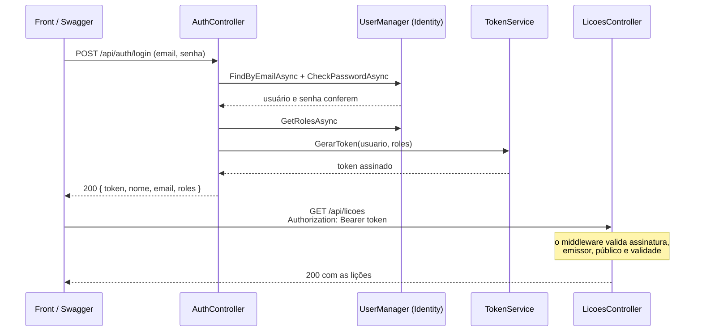

# MyHomework

Aplicação para organizar lições de casa por matéria. Cada matéria agrupa suas lições, e cada lição tem título, descrição, data de entrega e um status que acompanha o andamento: pendente, feita ou entregue.

Para usar a API é preciso ter uma conta. O cadastro e o login são feitos com o ASP.NET Core Identity, e a API identifica quem está chamando por um token JWT. Existem dois perfis: **Usuario**, que cuida das lições, e **Admin**, que também pode cadastrar, editar e apagar matérias.

O projeto é dividido em duas partes que conversam por HTTP:

- **backend**: uma API REST em ASP.NET Core que guarda os dados num banco MySQL;
- **frontend**: uma interface em React que consome essa API.

> **Atenção:** a autenticação já está pronta no backend, mas o frontend ainda não tem tela de login nem envia o token. Enquanto isso não for feito, as telas recebem `401` da API. Para testar, use o Swagger (veja [Testar pelo Swagger](#testar-pelo-swagger)).

## Sumário

- [Funcionalidades](#funcionalidades)
- [Tecnologias](#tecnologias)
- [Arquitetura](#arquitetura)
- [Estrutura de pastas](#estrutura-de-pastas)
- [Telas e navegação](#telas-e-navegação)
- [Modelo de dados](#modelo-de-dados)
- [Autenticação e permissões](#autenticação-e-permissões)
- [Ciclo de vida de uma lição](#ciclo-de-vida-de-uma-lição)
- [Exemplo de fluxo completo: criar uma lição](#exemplo-de-fluxo-completo-criar-uma-lição)
- [Endpoints da API](#endpoints-da-api)
- [Como rodar](#como-rodar)
- [Decisões do projeto](#decisões-do-projeto)
- [Fluxo de trabalho no Git](#fluxo-de-trabalho-no-git)
- [Próximas etapas](#próximas-etapas)

## Funcionalidades

**Contas**

- criar uma conta com nome, e-mail e senha;
- fazer login e receber um token JWT;
- consultar os dados do usuário logado;
- primeiro administrador criado automaticamente ao subir a API.

**Lições**

- listar todas as lições, da entrega mais próxima para a mais distante;
- filtrar por status (todas, pendentes, feitas ou entregues);
- destacar em vermelho as lições pendentes com data de entrega vencida;
- criar e editar lições pelo mesmo formulário;
- marcar uma lição como feita com um clique;
- apagar lições, com confirmação.

**Matérias**

- listar as matérias, cada uma com uma cor própria;
- cadastrar, editar e apagar matérias (só administradores);
- apagar matérias só é permitido se elas não tiverem lições.

A primeira migration já cadastra quatro matérias: Letras, Números, Artes e Natureza.

## Tecnologias

| Camada   | Tecnologia                                   | Uso                                            |
|----------|----------------------------------------------|------------------------------------------------|
| Backend  | .NET 10 e ASP.NET Core                       | API REST com controllers                       |
| Backend  | Entity Framework Core 10                     | acesso ao banco e migrations                   |
| Backend  | `MySql.EntityFrameworkCore`                  | provedor oficial do MySQL para o EF Core       |
| Backend  | ASP.NET Core Identity                        | usuários, hash de senha e roles                |
| Backend  | JWT Bearer (`Microsoft.AspNetCore.Authentication.JwtBearer`) | geração e validação de tokens  |
| Backend  | Swagger (Swashbuckle)                        | documentação e testes dos endpoints, com botão Authorize |
| Banco    | MySQL                                        | armazenamento de usuários, matérias e lições   |
| Frontend | React 19 com TypeScript                      | interface                                      |
| Frontend | React Router                                 | navegação entre as telas                       |
| Frontend | Vite                                         | servidor de desenvolvimento e build            |
| Frontend | `fetch` nativo                               | chamadas à API, sem bibliotecas extras         |

## Arquitetura

Cada camada só conversa com a camada vizinha. As telas não fazem requisições: elas chamam funções de `api.ts`. Os controllers não escrevem SQL: eles usam o `AppDbContext` (ou o `UserManager` do Identity, no caso dos usuários), que o Entity Framework traduz em comandos para o MySQL.

Antes de chegar aos controllers, toda requisição passa pelo middleware de autenticação, que lê o token do cabeçalho `Authorization` e descobre quem é o usuário. Depois, o middleware de autorização confere se ele pode acessar aquela rota.



O desenho do frontend, com as rotas de cada tela:


## Estrutura de pastas

```
backend/
  MyHomework.slnx
  MyHomework.Api/
    Controllers/
      AuthController.cs       cadastro, login e dados do usuário logado
      LicoesController.cs     endpoints de lições
      MateriasController.cs   endpoints de matérias
    Data/
      AppDbContext.cs         tabelas, regras e dados iniciais
      SeedData.cs             cria as roles e o primeiro admin
    DTOs/
      AuthDtos.cs             dados de cadastro, login e resposta do login
    Migrations/               histórico do esquema do banco
    Models/
      Licao.cs                classe Licao e enum StatusLicao
      Materia.cs              classe Materia
      Roles.cs                nomes das roles (Admin e Usuario)
      Usuario.cs              usuário do Identity com o campo Nome
    Services/
      TokenService.cs         gera o token JWT
    Program.cs                configuração: banco, Identity, JWT, JSON, Swagger, CORS

frontend/
  .env.example                modelo da variável com o endereço da API
  index.html
  src/
    api/
      api.ts                  todas as chamadas à API
    components/
      LicaoCard.tsx           card de uma lição
      Navbar.tsx              barra de navegação
    pages/
      LicoesPage.tsx          lista de lições com filtros
      LicaoFormPage.tsx       formulário de criar e editar lição
      MateriasPage.tsx        lista e cadastro de matérias
    utils/
      cores.ts                cor de cada matéria
      datas.ts                formatação de datas e regra de atraso
    types.ts                  formato dos dados da API
    App.tsx                   rotas
    index.css                 estilos
    main.tsx                  ponto de entrada

docs/                         imagens usadas neste README
```

## Telas e navegação

| Rota                  | Tela            | O que faz                                              |
|-----------------------|-----------------|--------------------------------------------------------|
| `/`                   | `LicoesPage`    | lista as lições, com filtros e ações em cada card      |
| `/licoes/nova`        | `LicaoFormPage` | formulário vazio para criar uma lição                  |
| `/licoes/:id/editar`  | `LicaoFormPage` | o mesmo formulário, preenchido com a lição escolhida   |
| `/materias`           | `MateriasPage`  | lista as matérias e permite cadastrar e apagar         |

A barra de navegação aparece em todas as telas. Na lista de lições, o botão "+ Nova lição" e o botão "Editar" de cada card abrem o formulário; ao salvar ou cancelar, o formulário volta para a lista. "Marcar como feita" e "Apagar" agem na própria lista, sem trocar de tela.

As telas de cadastro e login ainda não existem (veja [Próximas etapas](#próximas-etapas)).

## Modelo de dados

Uma matéria tem várias lições, e cada lição pertence a uma única matéria, ligada pelo campo `MateriaId`.

**Materia**

| Campo    | Tipo     | Observação                     |
|----------|----------|--------------------------------|
| Id       | int      | chave primária                 |
| Nome     | string   | obrigatório, até 60 caracteres |
| Icone    | string   | opcional, até 10 caracteres    |
| CriadaEm | DateTime | preenchido pela API            |

**Licao**

| Campo        | Tipo      | Observação                         |
|--------------|-----------|------------------------------------|
| Id           | int       | chave primária                     |
| Titulo       | string    | obrigatório, até 120 caracteres    |
| Descricao    | string    | opcional, até 500 caracteres       |
| DataEntrega  | DateTime  |                                    |
| Status       | enum      | `Pendente`, `Feita` ou `Entregue`  |
| ConcluidaEm  | DateTime? | preenchido ao concluir a lição     |
| CriadaEm     | DateTime  | preenchido pela API                |
| AtualizadaEm | DateTime? | preenchido pela API a cada edição  |
| MateriaId    | int       | chave estrangeira para `Materia`   |

**Usuario**

Herda de `IdentityUser`, que já traz `Id`, `Email`, `UserName`, `PasswordHash` e outros campos do Identity. O projeto acrescenta só um:

| Campo | Tipo   | Observação                      |
|-------|--------|---------------------------------|
| Nome  | string | obrigatório, até 100 caracteres |

A migration `AdicionaIdentity` cria as tabelas do Identity no banco: `AspNetUsers` (usuários), `AspNetRoles` (roles), `AspNetUserRoles` (qual usuário tem qual role) e as tabelas auxiliares.

Regras que valem para os dados:

- o status é gravado no banco como texto e aparece assim no JSON (`"Pendente"`, e não `0`);
- `CriadaEm`, `AtualizadaEm` e `ConcluidaEm` são preenchidos pela API, nunca pelo cliente;
- uma matéria só pode ser apagada se não tiver lições. A regra existe no banco (`DeleteBehavior.Restrict`) e também no controller, que responde com `400` e uma mensagem clara;
- a senha nunca é gravada: o Identity guarda só o hash;
- o e-mail é único, e o `UserName` de cada usuário é o próprio e-mail.

Por enquanto as lições não estão ligadas a um usuário: todo usuário logado vê todas as lições.

## Autenticação e permissões

### Roles

| Role      | Quem recebe                                        | O que pode fazer                                   |
|-----------|----------------------------------------------------|----------------------------------------------------|
| `Usuario` | toda conta criada em `POST /api/auth/registrar`    | ver matérias; ver, criar, editar e apagar lições   |
| `Admin`   | o primeiro administrador, criado pelo `SeedData`   | tudo o que o `Usuario` faz, mais cadastrar, editar e apagar matérias |

Ao subir, a API cria as duas roles se elas ainda não existirem. Ela também cria o primeiro admin com o e-mail e a senha de `AdminInicial:Email` e `AdminInicial:Senha`, guardados no User Secrets. Sem essa configuração, nenhum admin é criado.

### Regras de senha

- pelo menos 6 caracteres;
- pelo menos um número;
- pelo menos uma letra minúscula.

Maiúsculas e símbolos não são obrigatórios.

### Como funciona o login



1. O cliente envia e-mail e senha para `POST /api/auth/login`.
2. A API confere a senha com o Identity. Se o e-mail não existir ou a senha estiver errada, a resposta é a mesma nos dois casos: `401` com "E-mail ou senha inválidos.", para não revelar quais e-mails estão cadastrados.
3. Se der certo, o `TokenService` gera um JWT e a API devolve o token junto com o nome, o e-mail e as roles do usuário.
4. Nas próximas requisições, o cliente manda o token no cabeçalho `Authorization: Bearer <token>`.
5. Sem token, ou com um token inválido ou vencido, a API responde `401`. Com token válido, mas sem a role exigida, responde `403`.

### O que vai dentro do token

| Claim   | Conteúdo                         |
|---------|----------------------------------|
| `sub`   | Id do usuário                    |
| `email` | e-mail                           |
| `name`  | nome                             |
| `role`  | uma claim para cada role         |

O token é assinado com HMAC-SHA256 usando a chave `Jwt:Key`. Ele vale por `Jwt:ExpiracaoMinutos` minutos (120 por padrão). Emissor e público são `MyHomework.Api` e `MyHomework.Front`. A API confere a assinatura, o emissor, o público e a validade em toda requisição.

## Ciclo de vida de uma lição

| Ação                         | Endpoint                 | Efeito no status                         |
|------------------------------|--------------------------|------------------------------------------|
| Criar                        | `POST /api/licoes`       | sempre começa como `Pendente`            |
| Marcar como feita            | `PATCH .../concluir`     | vira `Feita` e registra `ConcluidaEm`    |
| Editar no formulário         | `PUT /api/licoes/{id}`   | pode ir para qualquer um dos três        |
| Apagar                       | `DELETE /api/licoes/{id}`| a lição deixa de existir                 |

Na tela, uma lição aparece como **atrasada** quando ainda está `Pendente` e a data de entrega já passou.

## Exemplo de fluxo completo: criar uma lição

O que acontece entre o clique em "Salvar" e a lição aparecer na lista:

1. O aluno preenche o formulário (`LicaoFormPage`) e clica em Salvar.
2. A tela chama `criarLicao(dados)`, em `api.ts`.
3. O `api.ts` envia um `POST /api/licoes` com os dados em JSON e o token no cabeçalho `Authorization`.
4. A API valida o token. Sem token válido, responde `401` e a lição não é criada.
5. O `LicoesController` confere no banco se a matéria informada existe.
6. Se não existe, a API responde `400` com "Matéria não encontrada.", e a tela mostra essa mensagem em vermelho.
7. Se existe, a API define o status como `Pendente`, preenche `CriadaEm`, grava a lição no MySQL e responde `200` com a lição criada.
8. A tela volta para a lista, que busca as lições de novo e já mostra a nova.

O passo 3 ainda depende do frontend passar a enviar o token.

## Endpoints da API

A documentação interativa fica em `http://localhost:5229/swagger` quando a API está rodando.

Na coluna **Acesso**: *público* não exige token; *logado* exige um token válido; *Admin* exige um token de alguém com a role `Admin`.

### Autenticação

| Método | Rota                  | Acesso  | Descrição                                  | Respostas     |
|--------|-----------------------|---------|--------------------------------------------|---------------|
| POST   | `/api/auth/registrar` | público | cria uma conta com a role `Usuario`        | 200, 400      |
| POST   | `/api/auth/login`     | público | confere e-mail e senha e devolve o token   | 200, 400, 401 |
| GET    | `/api/auth/me`        | logado  | devolve os dados que estão no token        | 200, 401      |

Exemplo de corpo para criar uma conta:

```json
{
  "nome": "Ana",
  "email": "ana@exemplo.com",
  "senha": "abc123",
  "confirmarSenha": "abc123"
}
```

O cadastro responde `400` quando falta algum campo, quando o e-mail é inválido, quando as senhas não conferem, quando o e-mail já está cadastrado ou quando a senha não segue as regras.

Exemplo de corpo para o login, e a resposta:

```json
{
  "email": "ana@exemplo.com",
  "senha": "abc123"
}
```

```json
{
  "token": "eyJhbGciOiJIUzI1NiIs...",
  "nome": "Ana",
  "email": "ana@exemplo.com",
  "roles": ["Usuario"]
}
```

### Matérias

| Método | Rota                 | Acesso | Descrição                                | Respostas               |
|--------|----------------------|--------|------------------------------------------|-------------------------|
| GET    | `/api/materias`      | logado | lista todas as matérias                  | 200, 401                |
| GET    | `/api/materias/{id}` | logado | busca uma matéria                        | 200, 401, 404           |
| POST   | `/api/materias`      | Admin  | cria uma matéria                         | 200, 400, 401, 403      |
| PUT    | `/api/materias/{id}` | Admin  | altera nome e ícone                      | 200, 401, 403, 404      |
| DELETE | `/api/materias/{id}` | Admin  | apaga a matéria, se ela não tiver lições | 204, 400, 401, 403, 404 |

### Lições

| Método | Rota                         | Acesso | Descrição                  | Respostas     |
|--------|------------------------------|--------|----------------------------|---------------|
| GET    | `/api/licoes`                | logado | lista todas as lições      | 200, 401      |
| GET    | `/api/licoes/{id}`           | logado | busca uma lição            | 200, 401, 404 |
| POST   | `/api/licoes`                | logado | cria uma lição             | 200, 400, 401 |
| PUT    | `/api/licoes/{id}`           | logado | edita uma lição            | 200, 401, 404 |
| PATCH  | `/api/licoes/{id}/concluir`  | logado | marca a lição como feita   | 200, 401, 404 |
| DELETE | `/api/licoes/{id}`           | logado | apaga uma lição            | 204, 401, 404 |

Exemplo de corpo para criar uma lição:

```json
{
  "titulo": "Ler o capítulo 1",
  "descricao": "Páginas 10 a 15",
  "dataEntrega": "2026-12-01T00:00:00",
  "materiaId": 2
}
```

Ao criar uma lição, a API ignora o que vier em `status`, `criadaEm`, `atualizadaEm` e `concluidaEm`: toda lição nova começa como `Pendente`. Se o `materiaId` não existir, a resposta é `400`.

## Como rodar

### Requisitos

- [.NET SDK 10](https://dotnet.microsoft.com/download)
- MySQL rodando localmente, na porta 3306
- Ferramenta do Entity Framework: `dotnet tool install -g dotnet-ef`
- [Node.js](https://nodejs.org/) 20.19 ou 22.12 em diante

### Backend

**1. Configurar os segredos**

Senhas e chaves não ficam no repositório. Em desenvolvimento elas são guardadas com o User Secrets do .NET, que salva os dados fora da pasta do projeto:

```bash
cd backend/MyHomework.Api

# conexão com o banco
dotnet user-secrets set "ConnectionStrings:Default" "server=localhost;port=3306;database=myhomework;user=root;password=SUA_SENHA"

# chave que assina os tokens: texto aleatório com pelo menos 32 caracteres
dotnet user-secrets set "Jwt:Key" "TROQUE-POR-UMA-CHAVE-ALEATORIA-COM-32-OU-MAIS-CARACTERES"

# primeiro administrador (a senha precisa seguir as regras de senha)
dotnet user-secrets set "AdminInicial:Email" "admin@exemplo.com"
dotnet user-secrets set "AdminInicial:Senha" "SUA_SENHA_DE_ADMIN"
```

Sem `Jwt:Key`, a API não sobe e mostra o aviso "Configure a chave Jwt:Key no User Secrets.". Sem `AdminInicial`, a API sobe normalmente, mas nenhum admin é criado.

O `appsettings.Development.json` traz a connection string com a senha em branco, só como referência do formato. O `appsettings.json` traz as configurações do JWT que não são secretas (`Issuer`, `Audience` e `ExpiracaoMinutos`).

**2. Criar o banco**

```bash
dotnet ef database update
```

O comando cria o banco `myhomework`, as tabelas de matérias e lições, as tabelas do Identity e as matérias iniciais.

**3. Subir a API**

```bash
dotnet run
```

A API fica em `http://localhost:5229`. Na primeira vez, ela cria as roles `Admin` e `Usuario` e o administrador configurado no passo 1.

Para parar a API, use `Ctrl + C`. Se ela continuar aberta, o próximo `dotnet build` falha com "o arquivo está sendo usado por outro processo".

### Testar pelo Swagger

1. Com a API rodando, abra `http://localhost:5229/swagger`.
2. Crie uma conta em `POST /api/auth/registrar`, ou use o admin configurado no User Secrets.
3. Faça login em `POST /api/auth/login` e copie o valor de `token` da resposta.
4. Clique em **Authorize** (o cadeado), cole só o token, sem a palavra `Bearer`, e confirme.
5. Agora as rotas protegidas funcionam. Teste com `GET /api/auth/me`, que mostra quem está logado.

Com uma conta comum, `POST /api/materias` responde `403`. Com o admin, a matéria é criada.

### Frontend

Com a API rodando, abra outro terminal:

```bash
cd frontend
npm install
```

Crie o arquivo `.env.local` a partir do modelo. Ele guarda o endereço da API e não vai para o repositório:

```bash
cp .env.example .env.local
```

No Windows (PowerShell), use `Copy-Item .env.example .env.local`. Se a sua API estiver em outra porta, ajuste o valor de `VITE_API_URL`.

Depois suba o servidor de desenvolvimento:

```bash
npm run dev
```

O site fica em `http://localhost:5173`, endereço que a API já libera no CORS. Enquanto o frontend não tiver login, as listas vão aparecer vazias ou com erro, porque a API responde `401`.

## Decisões do projeto

| Decisão | Motivo |
|---------|--------|
| Todas as chamadas HTTP ficam em `api.ts` | as telas não precisam conhecer endereços nem tratar erros de rede; trocar a URL da API muda um arquivo só |
| O card de lição não chama a API | ele só avisa a página ("clicaram em concluir"); quem fala com a API é a página, e o card fica simples de reaproveitar |
| Status salvo como texto | o banco e o JSON ficam legíveis (`Pendente` em vez de `0`) |
| Cor da matéria calculada pelo `id` | não precisa de coluna no banco e cada matéria mantém sempre a mesma cor |
| Senha do banco, chave do JWT e admin inicial no User Secrets | segredos nunca entram no Git, nem por engano |
| Endereço da API em `.env.local` | cada computador pode usar a sua porta sem mudar o código |
| Matéria com lições não pode ser apagada | evita lições sem matéria; a API explica o motivo em vez de devolver erro 500 |
| Identity para guardar usuários | hash de senha, regras de senha, e-mail único e roles prontos e testados, sem reinventar segurança |
| JWT em vez de cookie | a API e o React rodam em portas diferentes, e o token funciona igual no navegador, no Swagger e em qualquer outro cliente |
| DTOs no cadastro e no login | o cadastro tem campos que não existem no `Usuario` (senha e confirmação), e o `Usuario` tem campos que nunca devem sair da API, como o `PasswordHash` |
| Mesma mensagem para e-mail inexistente e senha errada | não revela quais e-mails têm conta |
| Toda conta nova é `Usuario` | ninguém consegue se cadastrar como admin; o único admin vem da configuração do servidor |
| Claims com nomes curtos (`sub`, `name`, `role`) e `MapInboundClaims = false` | o token fica menor e o que é gravado é exatamente o que a API lê, sem conversão para nomes longos |

## Fluxo de trabalho no Git

Cada parte do projeto foi feita numa branch própria e entrou no `main` por pull request. A autenticação, por exemplo, veio em três etapas: `feat/auth-identity` (Identity e cadastro), `feat/auth-jwt` (token e login) e `feat/auth-protect-routes` (rotas protegidas e Swagger com Authorize).

As mensagens de commit seguem o padrão [Conventional Commits](https://www.conventionalcommits.org/):

| Tipo       | Uso                                  | Exemplo                                                    |
|------------|--------------------------------------|------------------------------------------------------------|
| `feat`     | funcionalidade nova                  | `feat(backend): add login and me endpoints`                |
| `fix`      | correção de bug                      | `fix(licoes): validate materia on update`                  |
| `docs`     | documentação                         | `docs: add project README`                                 |
| `build`    | dependências                         | `build(deps): add react-router`                            |
| `chore`    | configuração e manutenção            | `chore(frontend): scaffold React app with Vite`            |

## Próximas etapas

Melhorias planejadas, agrupadas por área.

### Autenticação no frontend (prioridade)

| Melhoria | Por quê |
|----------|---------|
| Telas de cadastro e login | sem elas, o frontend não consegue usar a API, que agora exige token |
| Guardar o token e enviá-lo em `api.ts` | todas as chamadas precisam do cabeçalho `Authorization: Bearer` |
| Voltar para o login quando a API responder `401` | o token vence depois de 120 minutos |
| Botão "Sair" na barra de navegação | apagar o token guardado |
| Esconder as ações de matéria para quem não é admin | hoje a tela mostraria os botões, e a API responderia `403` |

### Backend

| Melhoria | Por quê |
|----------|---------|
| Ligar cada lição a um usuário | hoje todo usuário logado vê e altera as lições de todos |
| Exigir `Nome` não vazio na matéria (`[Required]`) | hoje a API aceita uma matéria com nome em branco; só o formulário do frontend impede |
| Validar a matéria também no `PUT` de lições | com um `materiaId` inexistente, a edição devolve erro 500 em vez de 400 |
| Ignorar o `id` enviado no `POST` | se o cliente mandar um `id`, a criação pode falhar com chave duplicada |
| Preencher `ConcluidaEm` quando o status virar `Feita` pelo `PUT` | hoje só o botão "Marcar como feita" registra a data |
| Usar DTOs também em lições e matérias | o cadastro e o login já usam; falta separar o que a API recebe do que ela grava nas outras rotas |
| Responder `201 Created` no `POST` | é a resposta padrão do HTTP para criação |
| Registrar no log quando o admin inicial não puder ser criado | se a senha do `AdminInicial` não seguir as regras, hoje o erro passa em silêncio |
| Atualizar os pacotes da Microsoft para a mesma versão 10.0.x | hoje há uma mistura de 10.0.11 e 10.0.12 |
| Remover o pacote `Microsoft.AspNetCore.OpenApi` | não é usado; a documentação vem do Swashbuckle |

### Frontend

| Melhoria | Por quê |
|----------|---------|
| Layout responsivo para celular | a tela foi pensada para computador |
| Filtro por matéria na lista de lições | hoje só existe o filtro por status |
| Editar o nome de uma matéria | a API já tem o endpoint, falta a tela |
| Botão "Marcar como entregue" no card | hoje só dá para mudar para `Entregue` pelo formulário |
| Contador de pendentes e atrasadas no topo | visão rápida do que falta fazer |
| Confirmação de exclusão com componente próprio | substituir o `confirm()` do navegador |

### Qualidade e entrega

| Melhoria | Por quê |
|----------|---------|
| Testes da API com xUnit | garantir as regras de negócio e as permissões a cada mudança |
| Testes do frontend com Vitest | testar componentes e funções como `estaAtrasada` |
| GitHub Actions | compilar e testar automaticamente a cada pull request |
| Docker Compose com API, MySQL e frontend | subir o projeto inteiro com um comando |
| Publicar a aplicação | deixar o projeto acessível fora do computador local |

### Novas funcionalidades

| Ideia | Descrição |
|-------|-----------|
| Lições por aluno | cada aluno vê só as próprias lições (depende de ligar a lição ao usuário) |
| Gerenciar usuários | tela de admin para listar contas e dar ou tirar a role `Admin` |
| Lembretes | avisar quando uma lição estiver perto do prazo |
| Calendário | ver as entregas organizadas por dia |
| Anexos | guardar uma foto ou arquivo junto com a lição |

A ordem sugerida é: primeiro o login no frontend, para o site voltar a funcionar; depois ligar as lições aos usuários e as correções da API; em seguida as melhorias de tela, testes e CI; então Docker e publicação; e por último as novas funcionalidades.
